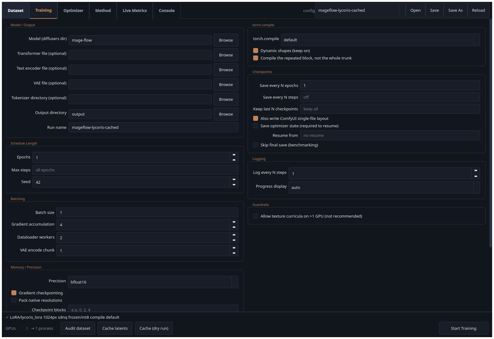

# Mage-Flow trainer

Train Mage-Flow adapters or finetune the full transformer through the GUI or CLI, with native model weights, native-resolution attention, and frozen Qwen3-VL text conditioning. Adapted from `diffusion-pipe-mageflow-ft` commit `40bf63a`, without requiring that checkout or DeepSpeed at runtime.

## This fork (MageTrail)

A fork of [bluvoll/mage-flow-trainer](https://github.com/bluvoll/mage-flow-trainer) for the MageTrail finetune. It adds the following, with upstream behaviour unchanged while each is off. See [docs/magetrail-features.md](docs/magetrail-features.md) for details, and [configs/mageflow-magetrail-finetune.toml](configs/mageflow-magetrail-finetune.toml) for a config using all of them.

- **StageLR** (`schedule.kind = "stage"`): chained linear / cosine / constant / REX stages fitted exactly to the run, applied to every param group.
- **Artist attribution:** `Drawn by <artist>` triggers kept intact through shuffle and dropout, for every credited artist, and written once in combined tags+NL captions.
- **TensorBoard / wandb / Trackio**, any combination (`[tracking]`). Includes per-component LR, grad norm and throughput, and runs that resume.
- **Validation samples during training** (`[sampling]`), with no resident text encoder and the work split across GPUs.
- **Held-out eval loss** at fixed timestep quantiles (`[eval]`).
- **Save now / Save & stop** from the GUI, or by touching `save` / `save_quit` in the run folder.
- **Per-artist datasets:** `dataset.subsets_file` reads Illustration Scrapping Studio's export. The cache can be stored as float16 (`dataset.latent_dtype`, `cache_latents convert`), and `cache-config` caches every folder in one process.

- **Remote training:** run the GUI on a laptop and train on a GPU box (Colab, JupyterHub, a rented pod). Paste the link the box prints, then Connect. See [docs/remote-training.md](docs/remote-training.md).
- **Faster startup at scale:** rank 0 scans the dataset once and shares it with the other ranks, and thousands of subset folders are scanned in parallel.

Trackers are optional: `pip install -r requirements-tracking.txt`.

## Why use this trainer?

- **Native SDNQ integration:** train the full transformer with INT8 weight storage, or keep frozen base weights in INT8 while training adapters. Quantized optimizer state and state offloading are separate options. AdaLN is excluded from LoRA training.
- **Caption augmentation without a resident text encoder:** precompute configurable caption variations into a persistent SQLite cache, then unload the encoder for training. Shuffle tags, drop tags, and mix tags with natural-language captions while trading storage for VRAM.
- **Native-resolution training:** cached Mage-VAE latents, aspect-ratio buckets, packed sequences, and PyTorch's built-in `torch_varlen` attention. No artificial 2048-pixel maximum.
- **Adapter choices:** PEFT LoRA and LyCORIS LoCon, LoKr (including configurable factor), and DoRA. LyCORIS supports compilation; LoCon/LoKr default to bypass, and DoRA uses weight decomposition on output.
- **Practical controls:** GUI configuration, gradient checkpointing, `torch.compile`, single-GPU or distributed training, adapter export, and resumable caches.

Experimental decoded-loss tools include [LPIPS](docs/decoded-perceptual-loss.md)
and an [eye-local adversarial loss](docs/eye-adversarial-loss.md), through a frozen
FLUX.2/VSF3 decoder. These are research options, not established eye-quality fixes;
the tested LPIPS variants did not improve the Houki portrait comparisons.

## SDNQ and consumer hardware

Training-mode INT8/UINT8 uses a compatibility fix for small-update preservation
with stochastic rounding. See the [rounding diagnosis and validation](docs/sdnq-integer-update-rounding.md)
before reusing learning rates from older quantized finetunes.

**For full-model finetuning on the 24 GB consumer GPUs targeted here, treat SDNQ as a practical requirement.** Updating 4.116 billion parameters requires space for weights, gradients, optimizer state, and activations. Use SDNQ **training mode**, INT8 weights, and a **Cached Text Encoder**; optimizer-state quantization and CPU offloading may also be necessary. Offloading shifts memory pressure to system RAM, so SDNQ alone does not guarantee that a configuration fits. Our [full-model smoke test](docs/bisque-finetune-smoke.md) used quantized, CPU-offloaded optimizer states.

**LoRA benefits less from SDNQ, but the savings are still welcome.** Only the small adapter is updated, so base-model gradients and optimizer states are already absent. SDNQ **frozen mode** reduces the base weights' VRAM footprint, leaving more room for image resolution or batch size. It is optional for LoRA when the unquantized model fits. Full finetuning without SDNQ remains supported for hardware with sufficient memory.

An [experimental compressed-modulation variant](docs/compressed-modulation.md) reduces the large block AdaLN projections while keeping them trainable. Use the dedicated [Load Compressed Mage-Flow custom node](https://github.com/bluvoll/ComfyUI-MageFlow-Compressed) for ComfyUI inference. It does not change ordinary Mage-Flow checkpoints or ComfyUI's built-in loaders.

## Experimental FLUX.3 Image Klein Base support

The GUI and CLI also support **FLUX.3 Image Klein Base** text-to-image adapters
and full finetuning, with native BF16 checkpoints, SDNQ UINT8 weight storage,
Cached Text Encoder embeddings, gradient checkpointing, compilation, and packed
`torch_varlen` attention. SDPA remains available. Reference-image editing and
distilled flow-map checkpoints are not supported.

**Support may be temporary.** Mage-Flow remains this trainer's primary focus.
If FLUX.3 Klein sees little adoption or is abandoned by the open-source community,
its experimental support may be discontinued or removed. Long-term maintenance
is not guaranteed.

Start with the [full-finetuning preset](configs/flux3-finetune-experimental.toml)
or [LoCon preset](configs/flux3-locon-experimental.toml), set your dataset/model
paths, and select `flux3` as the model family in the GUI. Cache latents with the
Flux3 package's own VAE; Mage-VAE and VSF3 caches are not interchangeable.

A **10-update test on two RTX 4090s**, at **512px and batch 2 per GPU**, completed
full text-to-image finetuning with UINT8 SDNQ, Adafactor, checkpointing, compile,
and varlen attention, **without CPU offload**:

| GPU | Peak allocated | Peak reserved |
|---|---:|---:|
| GPU 0 | 17.27 GiB | 17.45 GiB |
| GPU 1 | 17.30 GiB | 17.51 GiB |

Effective batch was 4, with a median **2.93 seconds/update** after the first step.
This controlled test repeated one cached image with an 80-token caption and
excluded checkpoint saving. It demonstrates execution and memory feasibility,
not convergence or a memory guarantee for other datasets.

Flux3 concatenates eight Qwen hidden layers into **20,480 features per token**.
BF16 cached embeddings cost **40 KiB per retained token** (20 MiB for a 512-token
caption, per unique variation). The finetuning preset caps text at **128 tokens**
to match the memory tests; raise `train.max_text_tokens` if captions are longer,
allowing for additional cache storage and VRAM.

See the [Flux3 guide](docs/flux3-experimental.md) for model layout, limitations,
validation, and licensing details.

## Experimental MOSS-Image support

**Support may be temporary.** Mage-Flow remains this trainer's primary focus.
If MOSS-Image sees little adoption or is abandoned by the open-source community,
its experimental support may be discontinued or removed. Long-term maintenance
is not guaranteed.

Native **MOSS-Image Base/SFT** supports full finetuning and PEFT/LyCORIS adapters,
SDNQ UINT8, Cached Text Encoder embeddings, packed `torch_varlen`, checkpointing,
compile, and GUI configuration. The 5.082B single-stream transformer uses shared
modulation and Qwen3.5-9B final-layer conditioning. Its packaged FLUX.2 VAE has
an /8 encoder and a smaller decoder; latent packing gives an effective /16 stride.
Use fresh latent caches with that VAE.

Under **Training → Checkpoints**, **MOSS Q/K/V saving format** defaults to fused
for full finetunes and plain LoRA/LoCon; separated remains selectable. Other models
and LoKr/DoRA keep their native layout. Fused LoRA/LoCon exports support loaders that expect
fused QKV, including the audited Forge loader. Convert an existing adapter with
`python lora_qkv_convert.py model.safetensors --format fused`, or launch
`python lora_qkv_convert.py` for a small GUI. It saves a new copy with the same
effective updates; fused adapters can be larger. See the
[export guide](docs/moss-image-experimental.md#qkv-saving-format-and-existing-loras).

For an experimental **MOSS LoCon ConvRot** comparison, install the optional kernels
in the trainer environment (`uv sync --extra gui --extra convrot`, or
`uv pip install --python .venv/bin/python comfy-kitchen==0.2.37`). Select
**Transformer quantization backend → ConvRot INT8 (experimental)** in the GUI,
with frozen mode, BF16 training/adapters, and LyCORIS LoCon bypass enabled.
Start from native BF16 MOSS weights: the trainer applies per-channel INT8
quantization with a 256-wide rotation, INT8 forward matmul and BF16 attention.
The adapter remains in the original weight basis and exports normally.
Text-encoder quantization and the optimizer remain independent SDNQ options.
SDNQ transformer storage dtype, matmul, group size and rounding controls do not
configure ConvRot. Full finetuning and other adapter algorithms are currently
rejected. This is an experimental speed/quality tradeoff, not lossless training.

Start with the [finetuning preset](configs/moss-image-finetune-experimental.toml)
or [LoCon preset](configs/moss-image-locon-experimental.toml), both defaulting to
1024px. Replace dataset and model paths. The [MOSS guide](docs/moss-image-experimental.md) documents the
supported checkpoint layout, validation, sampling choices, and limitations.
A ten-update 512px DDP full-finetune test at batch 1 per GPU peaked at **15.72 GiB
allocated per RTX 4090**, using cached short captions, UINT8 SDNQ, Adafactor,
checkpointing and compile, without CPU offload. This is experimental support;
smoke tests do not establish image quality or memory needs for longer captions.

## Start training

For a fresh environment, use `./install.sh` or `install.bat`. The tested environment uses PyTorch 2.10.0 + CUDA 12.8; dependencies are recorded in `uv.lock` and `requirements.txt`.

SDNQ is pinned to **0.2.4**, the version used to validate the trainer's optimizer
defaults and compatibility patches. Newer releases require separate validation.
If an existing environment installed a different release, activate that environment
and run `python -m pip install "sdnq==0.2.4" --no-deps`, then restart the trainer.
Check the installed version with
`python -c "from importlib.metadata import version; print(version('sdnq'))"`.

### GUI

<a href="docs/images/trainer-gui.png"></a>

*Training tab with the LyCORIS cached-text preset. Click the screenshot for full size.*

The GUI uses the same TOML configuration and training backend as the CLI. Launch it with `./start-gui.sh` on Linux or `start-gui.bat` on Windows after installation. To use this checkout's existing environment directly:

```bash
.venv/bin/python -m trainer.gui
```

At startup the GUI checks the current Git branch's configured upstream for updates,
including when running from a fork. If behind, it offers a fast-forward-only pull;
choosing No starts the current version. Local tracked edits or divergent commits
require a manual update. Missing Git, no upstream, or an unavailable network skips
the Git check and allows startup to continue. Accepting an update also refreshes the
active venv when `requirements.txt`, `pyproject.toml`, or `uv.lock` differs from its
last successful dependency installation. This includes pinned Git revisions such
as LyCORIS. With `uv`, the updater uses the lockfile and keeps additional packages;
otherwise it installs the pinned requirements with the venv's own Python/pip.
An independent launcher waits for the startup GUI process to exit completely
before installing packages (releasing Qt DLLs on Windows), then reopens it on
success. Installation output stays in the launcher's console.
Failures stop startup, retain a retryable state, and write
`.mageflow-trainer-update.log` inside the venv.

Manual pulls and existing venvs without a recorded dependency installation prompt
once for a package refresh too. Choose No to continue with existing packages.
The normal installers record their successful environment setup. This checks file
contents, not timestamps; it does not reinstall packages on every launch or modify
global Python. `--no-update-check` skips Git checking; `--no-dependency-check`
skips the package check. Both flags work through the launch scripts.

The config picker lists TOMLs by last modification time, newest first. **Autosave**
beside the run name defaults to on and saves the form when you press Start; editing
alone does not save. Turning it off uses a temporary launch TOML without changing
saved configs. Save and Save As remain available, and the trainer still records its
run configuration with the training output. Queued runs use their selected TOMLs.

Section headers collapse and expand without changing settings; each settings tab
also has Expand all / Collapse all. These choices and the autosave toggle are
remembered in the per-user `mage-flow-trainer/gui.json` preference file (under the
OS configuration folder, normally `~/.config` on Linux or `%LOCALAPPDATA%` on Windows).
**Preferences** lets you choose a TOML save folder. Alternatively, set it once at
launch with `python -m trainer.gui --config-dir "path/to/my configs"`. The picker
then lists that folder; existing TOMLs are not moved. A missing preference file or
an unset folder uses the repository's `configs/` directory as before.

### Queue several training configs

Open **Run Queue**, choose **Add TOMLs**, then drag rows or use **Move up/down** to
set their order. **Remove selected** removes the selected entries. **Start queue**
validates all configs, then caches and trains each sequentially using the selected
GPUs. The saved TOMLs are used directly; unsaved editor changes are not included,
and relative paths resolve from the trainer directory. Give each run a distinct
output directory/run name. Config files are not rewritten.

Row statuses show caching, training, completion, failure, or skipped runs. An error
stops the remaining queue; **Stop** stops the current process and cancels later
runs. Editing a queued file after validation stops that queue before its next
step; restart the queue to use the edited file. The queue is kept for the current
GUI session, not restored after an application restart.

**Live Metrics** shows elapsed training time in `HH:MM:SS`, updating even while
graphs are paused or cleared and preserving the final duration after exit. It is
wall time for the current training process, including model loading, text caching,
compilation and saves. Separate latent-cache jobs are excluded. Each queued or
resumed training process starts a new clock; prior sessions are not accumulated.

For a single run:

1. Load a preset and choose a run name. Under **Model / Output**, select a Diffusers directory or separate transformer, text encoder, and VAE files.
2. Set your dataset folder and resolution, then use **Cache latents** to prepare images for training from cached latents.
3. In **Method**, choose PEFT LoRA, LyCORIS LoCon/LoKr/DoRA, or full finetuning. Configure SDNQ for that mode. Full finetuning exposes **Train AdaLN**; adapters always leave AdaLN frozen.
4. Enable **Cache text embeddings** and set **Caption variations per image** above zero for augmented caching. Choose caption augmentation settings before starting; the trainer prepares missing embeddings automatically.
5. Select the GPU(s), check batch size and training duration, and click **Start Training**. Multi-GPU training is available on Linux; Windows uses one selected GPU. The GUI displays progress and logs, and **Save / Save As** writes a TOML config you can also run from the CLI.

Adding dataset subset rows disables the single dataset folder and its repeat count;
remove all rows to restore them. Subsets replace the single-folder source.

**Enable advanced experimental features** reveals an Experimental tab for Self-Flow,
dual-timestep noising, RTI (Region Token Interface), decoded perceptual/eye LPIPS
supervision, and eye adversarial loss. Revealing the tab does not activate a loss.
Configs with an active experiment reveal it automatically; disable those features
before hiding the tab. This visibility toggle does not change saved training settings.

### Compiled Loaded Text Encoder

Qwen3 compilation is independent of Mage-Flow compilation and quantization.
To keep Qwen3 in BF16 while using SDNQ for the transformer, merge these
settings into your existing config:

```toml
[train]
dtype = "bfloat16"
cache_text_embeddings = false
compile_text_encoder = true
text_encoder_embedding_only = true

[quant]
quantize_text_encoder = false
# Keep your transformer's existing mode and weights_dtype settings.
```

In the GUI, disable **Cache text embeddings**, enable **Compile Loaded Text
Encoder** and **Loaded Text Encoder: embedding-only output** under
**torch.compile**, and disable text encoder quantization under SDNQ. Restart
an already-open GUI to see the new controls. Both new options default to false
and apply only to the Loaded Text Encoder; cache generation is unchanged.

Compilation uses dynamic decoder blocks and adds startup overhead. The
embedding-only path skips unused outputs and verifies equivalence with the
original wrapper on the first batch; an incompatible Transformers version
raises an error with instructions to disable that option. SDNQ encoder
quantization can also be enabled independently when VRAM is tighter.
See the [batch-size benchmark](docs/text-encoder-large-batch-benchmark.md)
for measured speed, memory, and numerical differences on RTX 4090.

### CLI and model paths

Put the native transformer, Qwen3-VL text encoder/tokenizer, and Mage-VAE under `mage-flow/`, or set `train.model_path`. See the [training guide](docs/training-guide.md) for the expected directory layout and full configuration reference.

Alternatively, select separate files in the GUI's **Model / Output** group:

```toml
[train]
transformer_path = "/path/to/magetrail.safetensors"
text_encoder_path = "/path/to/qwen3vl_4b_bf16.safetensors"
vae_path = "/path/to/mage-flow-vae.safetensors"
```

Each file overrides that component from `model_path`; when all three are supplied, no Diffusers directory is needed. The Qwen3-VL-4B configuration and tokenizer are bundled for offline loading. `tokenizer_path` optionally selects another local tokenizer directory. Native Mage-Flow transformer weights and BF16 Qwen3-VL-4B weights are supported; SDNQ quantization is applied after loading. Changing the text encoder/tokenizer selects a new text-cache namespace, while changing only the transformer leaves text embeddings reusable.

Cache images with matching `.txt` captions first:

```bash
.venv/bin/python -m trainer.tools.cache_latents cache /path/to/dataset \
  --model-path mage-flow --resolution 1024 --max-bucket-reso 8192
```

For a separate VAE, replace `--model-path mage-flow` with `--vae-path /path/to/mage-flow-vae.safetensors`. The GUI passes your selected VAE file to latent caching automatically.

Copy [the benchmark preset](configs/mageflow-readme-benchmark.toml), change `dataset.path` and `train.model_path`, then run:

```bash
CUDA_VISIBLE_DEVICES=0 .venv/bin/python -m trainer.training.train configs/my-run.toml
```

This preset is derived from `bisque-mageflow-lora-SDQN-AdamW.toml`, with batch size 1, accumulation 1, and a 10-step limit. For a real run, increase/remove `max_steps` and enable checkpoint/final saves. The original local preset uses larger batches and is not the configuration measured below.

## Timestep sampling preview

**Method → Flow Matching** includes a live probability plot. Adjust the sampler,
sigmoid scale, or shift to see the distribution, median, and fraction of draws at
`t >= 0.9`. Hover a bar for its probability. `t=0` is clean and `t=1` is pure noise;
this plot shows sampling frequency, not loss weighting. Resolution-aware shift
has a preview-only latent grid selector. Curriculum range mapping is not shown.

Choose `moss` for the **Kohaku static MOSS recipe**, independently implemented
from its probability law. The GUI sets and locks `sigmoid_scale=1`, `shift=1`,
and `flux_shift=false`. TOML loading rejects conflicting explicit values.
Existing configurations retain their sampler; this is an opt-in experiment.

```toml
[flow]
timestep_sample_method = "moss"
shift = 1.0
sigmoid_scale = 1.0
flux_shift = false
moss_mu = -1.09
moss_std = 0.95
moss_cutoff = 0.95
moss_uniform_mix = 0.01
moss_p_full = 0.0
moss_steps = 1000
```

The MOSS fields above are defaults. `moss_std` controls this sampler's width.
Its cutoff truncates the underlying inverted logit-normal variable **before
rescaling onto the full grid**, so returned timesteps still reach `1.0`.
The uniform mixture adds coverage across the grid; `moss_p_full` optionally adds
extra mass at pure noise. The final grid bin already has nonzero probability
when `moss_p_full=0`. This implements the static recipe, not a staged schedule.

## Dual-timestep noising (experimental)

Enable **Dual-timestep noising** in the GUI's flow settings, or add:

```toml
[flow]
dual_timestep = true
dual_timestep_mask_ratio = 0.25
```

This implements the dual-timestep noising component of
[Self-Flow](https://arxiv.org/abs/2603.06507): each image receives two sampled
noise levels, with the second assigned to a random fraction of image tokens.
Each token is conditioned on its own timestep; text keeps the primary timestep.
Both draws use your configured timestep distribution, shift and curriculum range.
The mask ratio must be greater than zero and at most 0.5.

This noising toggle alone adds no EMA teacher or feature-alignment loss. Cached
latents and Cached Text Encoder embeddings remain reusable. It works with
adapters and finetuning, including native-resolution packing, checkpointing and
the high-frequency loss. Inference and checkpoint weight layouts are unchanged.
It defaults to off. Faster convergence on Mage-Flow finetunes is a hypothesis
to evaluate against ordinary training; individual steps are not guaranteed faster.

For an EMA teacher and feature-alignment loss, enable **Method → Experimental
Self-Flow** in the GUI. It supports full finetuning with configurable batch size,
mixed-resolution packing, Cached Text Encoder, cached latents and DDP. Mixed EMA
stores attention/MLP weights in BF16 with stochastic rounding while keeping AdaLN
EMA in FP32. Inference checkpoints remain native; full resume state includes the
teacher and training-only projector. See [Self-Flow setup and constraints](docs/self-flow-training.md).

## Augmented text cache

```toml
[dataset]
path = "/path/to/dataset"
source = "latents"

[train]
cache_text_embeddings = true
caption_variations = 5
text_cache_batch_size = 4 # Captions per GPU per encoding batch; independent of training batch size.
# Optional; defaults to caption_variations.sqlite alongside the dataset.
caption_cache_path = ""
```

The number of variations controls deterministic augmentation attempts per image. Exact caption matches share one embedding, while duplicate selection slots retain their probability. Training cycles through shuffled variation slots across image visits; the cache does not grow with epoch count. Caption dropout uses a shared empty-caption embedding. A complete, compatible cache skips loading the text encoder on subsequent runs.

Under DDP, missing embeddings are split across all selected GPUs and committed to the shared SQLite cache. The distributed timeout is 60 minutes; cached entries are reusable when changing the number of GPUs.

Storage depends on the **actual unpadded token count**, not just the number of variations. A BF16 embedding with 2,560 features costs `tokens × 2,560 × 2` bytes. The following projection assumes **200 tokens per unique variation**, no deduplication, one cached image resolution, and excludes SQLite metadata and filesystem overhead.

| Unique variations per image | Text cache / image | Text + 1024² latent / image | Text cache / 20,000 images |
| ---: | ---: | ---: | ---: |
| 1 | 0.98 MiB | 2.98 MiB | 19.07 GiB |
| 5 | 4.88 MiB | 6.88 MiB | 95.37 GiB |
| 10 | 9.77 MiB | 11.77 MiB | 190.73 GiB |
| 25 | 24.41 MiB | 26.41 MiB | 476.84 GiB |
| 50 | 48.83 MiB | 50.83 MiB | 953.67 GiB |
| 100 | 97.66 MiB | 99.66 MiB | 1907.35 GiB |

Each additional unique 200-token variation adds **0.98 MiB per image**, or **19.07 GiB for 20,000 images**. At 512 tokens, that becomes 2.50 MiB per variation. Exact deduplication reduces the payload; duplicate slots and database overhead still occupy some storage.

FP32 Mage latents have 128 channels at 1/16 spatial resolution: approximately **2 MiB at 1024²**, **8 MiB at 2048²**, **18 MiB at 3072²**, and **32 MiB at 4096²**, once per cached image resolution. See [caption-cache behavior and invalidation](docs/caption-variation-cache.md).

## Measured VRAM

Measured on RTX 4090 24 GB GPUs with PyTorch 2.10.0+cu128. Every passing trial completed **10 optimizer steps**, **batch size 1 per GPU**, accumulation 1, rank/alpha 32, BF16 adapters, INT8 SDNQ frozen base weights (`all_adaln` skip policy), gradient checkpointing, `torch.compile`, packed `torch_varlen` attention, and **Cached Text Encoder (five augmented variations per image)** with cached image latents. The `adamw8bit` preset uses Kahan compensation with **optimizer-state quantization and offloading disabled**.

Ten large, file-deduplicated images from the Nicorima dataset were used. Sources are approximately 2K; larger tiers deliberately upscale them to test capacity. Resolutions are target-area tiers with aspect-ratio buckets, not fixed square dimensions. Single-GPU tests use GPU 1; dual-GPU tests use GPUs 0 and 1. GPU 0 retains approximately 1.4–1.6 GiB of desktop usage. CUDA reports about 23.52 GiB usable capacity per card.

Cached Text Encoder means training reads precomputed text embeddings; the encoder itself is unloaded.

Values below are **peak PyTorch allocated / reserved GiB per GPU**, including the first training step. They exclude external processes, CUDA context, and NCCL allocations. Model/cache initialization is recorded separately in the detailed results. OOM means a tested tier failed, not an exact resolution limit. These are short memory tests, not training-quality benchmarks.

### Single GPU

| Resolution tier | LyCORIS LoCon | PEFT LoRA |
| ---: | --- | --- |
| 1024 | 6.75 / 7.05 | 6.75 / 7.07 |
| 2048 | 9.88 / 10.55 | 9.88 / 10.55 |
| 3072 | 15.11 / 16.21 | 15.11 / 16.21 |
| 4096 | 22.44 / 23.04 | 22.44 / 23.04 |
| 5120 | OOM | OOM |

### Dual GPU (DDP)

| Resolution tier | LyCORIS LoCon | PEFT LoRA |
| ---: | --- | --- |
| 1024 | GPU 0: 6.99 / 7.19; GPU 1: 6.97 / 7.17 | GPU 0: 6.99 / 7.15; GPU 1: 6.97 / 7.11 |
| 2048 | GPU 0: 9.88 / 10.41; GPU 1: 9.87 / 10.22 | GPU 0: 9.88 / 10.41; GPU 1: 9.86 / 10.22 |
| 3072 | GPU 0: 14.97 / 15.82; GPU 1: 14.97 / 16.02 | GPU 0: 14.97 / 16.02; GPU 1: 14.96 / 16.02 |
| 4096 | OOM | OOM |
| 5120 | Not run (lower tier OOM) | Not run (lower tier OOM) |

DDP replicates the model on each GPU; it does not combine the cards into one 48 GB memory pool. Batch size 1 per GPU gives a global batch of 2, so ten dual-GPU steps process twenty image samples. See the [methodology and raw measurements](docs/readme-vram-benchmark.md) for timings, initialization memory, and reproduction commands.

### Batch-size sweep — GPU 1 only

Fixed **1024-area resolution**, **Cached Text Encoder**, cached image latents, and the same INT8, rank-32, compiled varlen settings above. Each passing batch size completed ten full optimizer steps with accumulation 1. Values are peak **allocated / reserved GiB**. Batch size increases by one in a fresh process until CUDA OOM.

| Batch size | LyCORIS LoCon | PEFT LoRA |
| ---: | ---: | ---: |
| 1 | 6.75 / 7.07 | 6.75 / 7.07 |
| 2 | 7.84 / 8.14 | 7.84 / 8.14 |
| 3 | 8.88 / 9.25 | 8.88 / 9.25 |
| 4 | 9.96 / 10.58 | 9.96 / 10.58 |
| 5 | 11.01 / 11.71 | 11.01 / 11.71 |
| 6 | 12.08 / 12.90 | 12.08 / 12.90 |
| 7 | 13.13 / 14.06 | 13.13 / 14.06 |
| 8 | 14.20 / 15.27 | 14.20 / 15.27 |
| 9 | 15.24 / 16.46 | 15.24 / 16.46 |
| 10 | 16.32 / 17.46 | 16.32 / 17.46 |
| 11 | 17.37 / 18.67 | 17.37 / 18.67 |
| 12 | 18.45 / 19.80 | 18.45 / 19.80 |
| 13 | 19.54 / 21.07 | 19.54 / 21.07 |
| 14 | 20.58 / 21.95 | 20.58 / 21.95 |
| 15 | 21.69 / 22.99 | 21.69 / 22.99 |
| 16 | OOM | OOM |

Both backends completed ten steps at every batch size from **1 through 15**. At batch size **16**, both hit CUDA OOM during the fifth step, after four successful steps. Batch size 15 peaked at **21.69 GiB allocated**; this measured limit applies to the stated 1024-area configuration and caption pool.

See the [batch-size methodology and per-step measurements](docs/batch-size-vram-benchmark.md). Dataset repeats ensure full batches; the source pool remains the same ten images.

### Full-model finetuning smoke test

On the 384-image Bisque dataset, a **10-step full-model test** passed on GPU 1 at batch size 1 and 1024-area resolution with **Cached Text Encoder**. All 4.116 billion transformer parameters were enabled for training. INT8 SDNQ training mode with quantized, CPU-offloaded optimizer states peaked at **14.28 GiB allocated / 16.31 GiB reserved**. Model computation and gradients use BF16; optimizer and loss calculations retain FP32 intermediates.

See the [test and dtype audit](docs/bisque-finetune-smoke.md) and [full-finetuning preset](configs/mageflow-finetune-cached-int8.toml).

## Documentation and license

- [Training and configuration guide](docs/training-guide.md)
- [Caption variation cache](docs/caption-variation-cache.md)
- [Masked training (painted loss masks)](docs/masked-training.md)
- [SNR-gated HF and paired texture losses](docs/detail-losses.md)
- [Experimental Flux3 text-to-image training](docs/flux3-experimental.md)
- [Experimental MOSS-Image training](docs/moss-image-experimental.md)
- [Reproducible benchmark preset](configs/mageflow-readme-benchmark.toml)
- [Benchmark methodology and detailed results](docs/readme-vram-benchmark.md)

The combined trainer is GPL-3.0. Vendored Mage-Flow and related components retain their respective notices; see [LICENSE](LICENSE) and [NOTICE](NOTICE).
